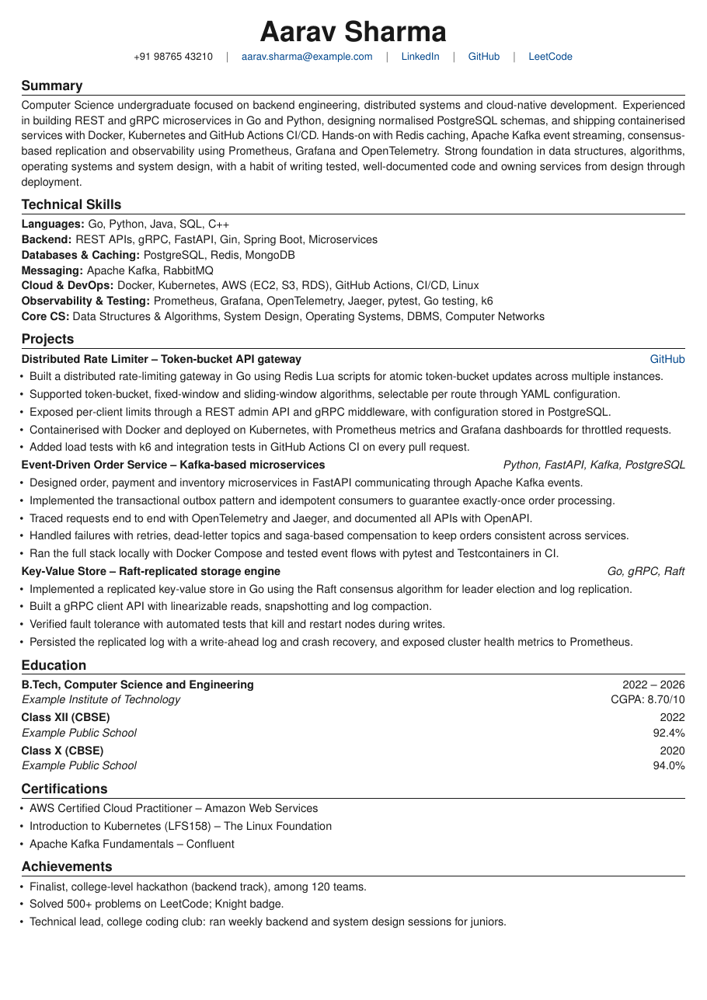
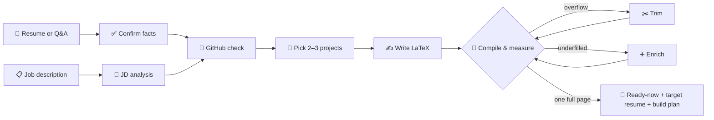

<div align="center">

# 📄✨ pseudoCV

### Plan, tailor and perfect your resume for any job description, in one chat.

*A Claude plugin that reads the JD, checks your GitHub, and gives you a ready-now resume from your real work,<br>plus an optional target resume that shows exactly what to build next.*

<br>


[**🚀 Quick start**](#-quick-start) · [**✨ Features**](#-features) · [**🖼️ Sample**](#%EF%B8%8F-sample-output) · [**⚙️ How it works**](#%EF%B8%8F-how-it-works) · [**❓ FAQ**](#-faq)

</div>

---

## 🤔 Why pseudoCV?

> Most resumes get filtered out by ATS before a human reads them, and most student resumes list the same tutorial
> projects recruiters have seen a thousand times.

pseudoCV fixes both problems:

| 😩 Without it | 😎 With pseudoCV |
|---|---|
| One generic resume sent to every job | A resume rewritten for **each** JD |
| Missing the exact keywords the ATS scans for | JD keywords in their **exact** spelling, used naturally |
| To-do apps and Netflix clones | **JD-matched, non-tutorial** projects with real engineering depth |
| Half-empty page, or spilling onto page 2 | **Compiled and measured** until it fills exactly one page |
| "Responsible for…" and "worked on…" | Crisp **verb + what + stack + result** bullets |
| No idea what to learn next | A **gap report**, a **target resume** and a **build plan** with reference repos |

---

## ✨ Features

<table>
<tr>
<td width="50%" valign="top">

### 🧭 Two ways to start
- 📎 **Have a resume?** Upload it. Every detail is extracted automatically.
- ✍️ **Starting from zero?** Answer a few grouped questions and you're done.

### 📄 Two resumes, one plan
- ✅ **Ready-now resume:** only your real work, safe to send today
- 🎯 **Target resume** (opt-in): what a *perfect* resume for this JD looks like, to plan your next projects

### 🎯 JD analysis
- Pulls out must-haves, nice-to-haves and seniority
- Captures the **exact keyword phrases** ATS systems match
- Optionally researches the company's tech stack

### 🐙 GitHub check
- Reads your public repos and READMEs
- Rates each one's relevance to the JD
- Uses only the numbers your repos actually state

</td>
<td width="50%" valign="top">

### 🧩 Smart project picks
- **2 projects** if you have solid experience, **3** if you don't
- Ready-now: your best real projects, ordered by JD fit
- Target: adds **strong reference projects** tied to the JD
- Bans tutorial clones by design

### 📏 Perfect page fit
- Compiles the LaTeX and **measures page fill**
- Trims if it overflows, enriches if it looks empty
- Never shrinks fonts or margins

### 🛡️ Honest by design
- Never invents jobs, dates, grades or certifications
- Never links someone else's repo as yours
- Target resume is opt-in, with a clear **build it before you send it** disclaimer

</td>
</tr>
</table>

---

## 🖼️ Sample output

<div align="center">

<br>
<sub>📌 Fictional new-grad backend engineer · one page · 94.8% filled · source in <a href="examples/"><code>examples/</code></a></sub>
</div>

---

## 🚀 Quick start

<details open>
<summary><b>💻 Claude Code (plugin, recommended)</b></summary>

```text
/plugin install pseudo-cv --marketplace AIZEN-Hado/pseudoCV
```

</details>

<details>
<summary><b>💬 Claude.ai / Claude desktop app (skill upload)</b></summary>

1. Download **`pseudo-cv.zip`** from [**Releases**](../../releases).
2. Make sure **Code execution and file creation** is on (**Settings → Capabilities**).
3. Go to **Customize → Skills → + → Create skill → Upload a skill**.
4. Upload the zip and switch it on. ✅

> Works on Free, Pro, Max, Team and Enterprise plans.

</details>

<details>
<summary><b>📁 Claude Code (manual skill install)</b></summary>

```bash
git clone https://github.com/AIZEN-Hado/pseudoCV.git
cp -r pseudoCV/skills/pseudo-cv ~/.claude/skills/
```

</details>

<details>
<summary><b>🔌 Claude API / Agent SDK</b></summary>

Upload the `skills/pseudo-cv/` folder as a custom skill. See the
[Agent Skills docs](https://docs.claude.com/en/docs/agents-and-tools/agent-skills/overview).

</details>

> **Requirements:** none to generate a resume — the LaTeX output pastes straight into [Overleaf](https://www.overleaf.com). For the **automatic one-page check** (`check_one_page.py`), install **Python 3** and a LaTeX engine (`pdflatex`, `xelatex` or `tectonic`). Without them the check is skipped and you compile in Overleaf instead.

### 💡 Then just ask

```text
Here's my resume (attached) and the JD for a Backend Engineer role at Acme.
<paste job description>
Make me the perfect resume for this.
```

```text
I don't have a resume yet. Build one for this Data Analyst internship: <paste JD>
```

---

## 📦 What you get back

| # | Output | Description |
|:-:|---|---|
| 1️⃣ | **📊 Gap report** | Every JD must-have marked ✅ has it · ⚠️ weak · ❌ missing |
| 2️⃣ | **✅ Ready-now resume** | Full LaTeX from your real work. Paste it into [Overleaf](https://www.overleaf.com) → Recompile → done |
| 3️⃣ | **🎯 Target resume** *(opt-in)* | The perfect resume for this JD, including projects to build |
| 4️⃣ | **⚠️ Disclaimer** | In chat: build and understand every target project before you send it |
| 5️⃣ | **🛠️ Build plan** | Reference repos, what to build and the order to build it in |
| 6️⃣ | **🔗 Sources** | Everything the skill looked up |

---

## ⚙️ How it works



---

## 🗂️ Repository structure

```text
📦 pseudoCV
├── 📁 .claude-plugin/
│   ├── plugin.json                ← plugin manifest
│   └── marketplace.json           ← lets anyone install from this repo
├── 📁 skills/pseudo-cv/           ← the skill
│   ├── 📜 SKILL.md                ← workflow Claude follows
│   ├── 📁 references/
│   │   ├── intake.md              ← questions for each path
│   │   ├── github-check.md        ← how repos are checked
│   │   ├── project-selection.md   ← how projects are chosen + quality bar
│   │   └── latex-rules.md         ← page budget, bullets, ATS, escaping
│   ├── 📁 assets/
│   │   └── resume-template.tex    ← fixed one-page template
│   └── 📁 scripts/
│       └── check_one_page.py      ← compiles + measures page count and fill
├── 📁 examples/                   ← fictional sample (.tex)
├── 📁 docs/                       ← README images
└── 📄 LICENSE
```

### 🧪 Check any resume yourself

```bash
python3 skills/pseudo-cv/scripts/check_one_page.py my_resume.tex --keep-pdf
```

| Result | Meaning |
|---|---|
| `OK` | ✅ One page, ≥ 94% filled |
| `UNDERFILLED` | ➕ Empty space at the bottom: add detail |
| `OVERFLOW` | ✂️ Spills onto page 2: trim |
| `LEFTOVER_PLACEHOLDERS` | 📝 Unfilled `<<...>>` items |
| `NO_LATEX` | 💡 No compiler found: use Overleaf instead |

> 🔧 Requires `pdflatex` (TeX Live with `tex-gyre`) or `tectonic`, plus `pdftotext` from poppler to measure fill.

---

## ❓ FAQ

<details>
<summary><b>Does it guarantee I pass the ATS?</b></summary>
<br>
No tool can guarantee that. pseudoCV uses ATS-friendly structure and the JD's exact keywords, which is what
ATS systems actually look for. It never shows a fake "ATS score".
</details>

<details>
<summary><b>What's the difference between the ready-now and target resumes?</b></summary>
<br>
The <b>ready-now</b> resume uses only your real work, so you can send it today. The <b>target</b> resume is opt-in:
it shows what a <i>perfect</i> resume for the JD looks like, including projects you still need to build, so you
know exactly what to work on. <b>Only send the target version once you've actually built those projects and can
explain them.</b>
</details>

<details>
<summary><b>Will it make up my experience, grades or certifications?</b></summary>
<br>
Never. Jobs, dates, CGPA, 10th/12th marks, certifications and achievements come only from you.
</details>

<details>
<summary><b>Can I use my own template?</b></summary>
<br>
Yes. Replace <code>skills/pseudo-cv/assets/resume-template.tex</code> and keep the <code>&lt;&lt;PLACEHOLDER&gt;&gt;</code> style.
</details>

---

## ⚠️ Responsible use

> [!IMPORTANT]
> pseudoCV is a **planning tool**. The ready-now resume contains only your real work. The optional target
> resume is a goal: send it only after every project on it is **genuinely yours** and you can explain every line in
> an interview. Using a reference repo for inspiration is fine; copying it and claiming it isn't.
> **Don't falsify your resume.**

---

## 🔒 Data & code

- **No servers, no hooks, no auto-run.** pseudoCV is a skill — it has no MCP servers, hooks, background processes, or `bin/` executables. Nothing runs automatically.
- **One optional script, run only with your approval.** `skills/pseudo-cv/scripts/check_one_page.py` compiles the generated LaTeX to confirm it fits one page. Claude runs it only when you approve it — on your machine in Claude Code, or in Anthropic's sandbox on claude.ai. It reads only the `.tex` being checked, makes **no network calls**, and sends nothing to the author or any third party. If Python or LaTeX isn't available, the check is skipped and you compile in [Overleaf](https://www.overleaf.com) instead.
- **Your data stays with you.** pseudoCV collects, stores, and transmits nothing. Your resume, the job description, and any web lookups are handled by Claude under Anthropic's own terms — the author never receives any of it.

---

## 🤝 Contributing

Contributions are welcome! 🎉
- 🎨 New resume templates
- 🧠 Better project-selection heuristics
- 🌍 Region-specific formats (US, EU, India)
- 📄 More examples

Open an issue or a pull request.

---

<div align="center">

### ⭐ If pseudoCV helped you land an interview, give it a star!

It helps other students find it. 💙

Made with ❤️ by **Yash Chauhan** · Licensed under [MIT](LICENSE)

</div>
